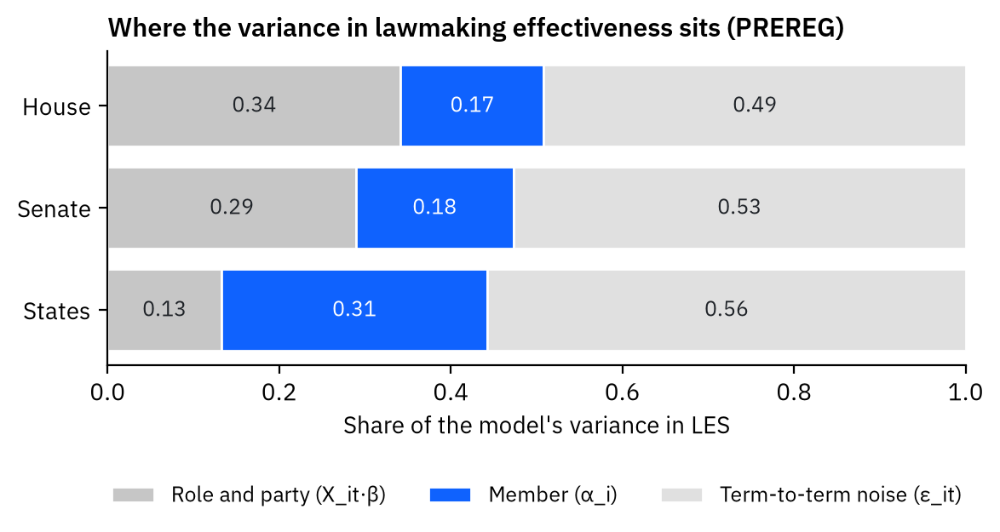
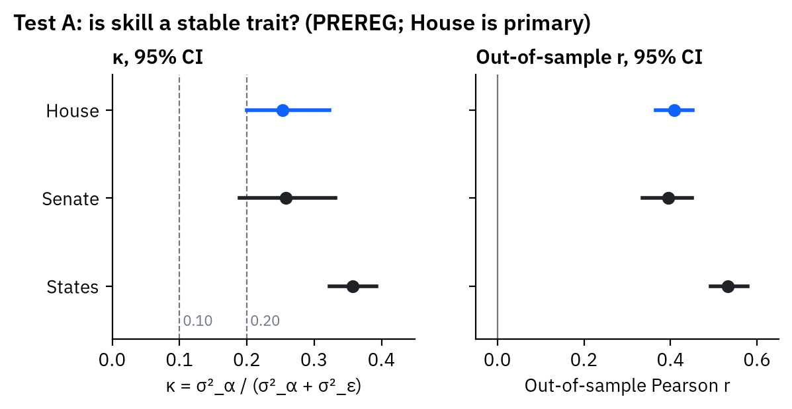
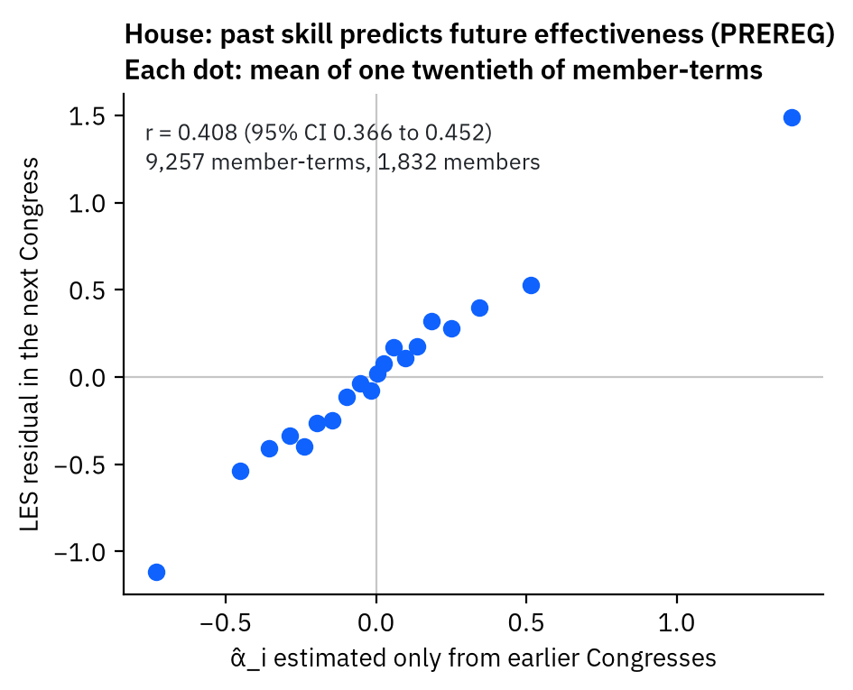
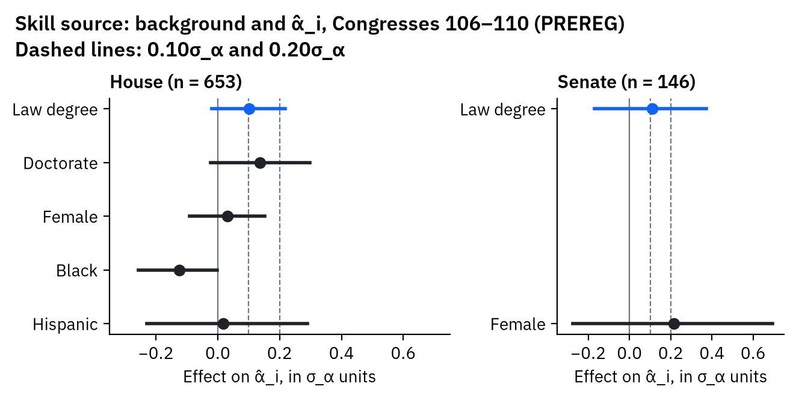
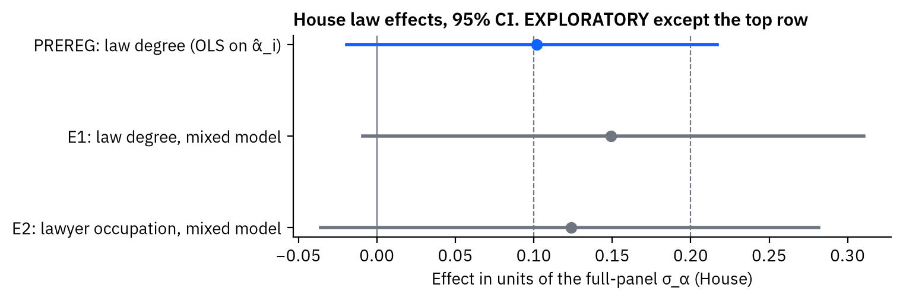

<!-- Every number in this post comes from a var shortcode (written by code/step5_numbers.py from output/)
     or from a table in output/tables/. Thresholds are quoted from PREREG.md. -->

I'm deciding whether to go to law school. My reason for going would be to become someone who makes good policy. That reason depends on three premises:

- **A.** Effective policymakers are a bottleneck for solving world problems.
- **B.** Scientists and economists are not the bottleneck. The answers exist but go unused.
- **C.** Law school is a good way to become an effective policymaker.

Before running any model, I wrote down the tests and the decision rules in a pre-registration ([`PREREG.md`](PREREG.md)). This post reports the parts I could run so far: Test A, and the "skill source" test, which is the first half of C. The results come first, exactly as pre-registered. After that come the places I departed from the plan, then the analyses I added later, which are labeled **exploratory**.

**Short version.** In Congress, some legislators really are more effective than others, year after year. That part of premise A holds up. But members with a law degree are not detectably more effective than members without one. Under my own pre-registered rule, the data gives no recommendation for law school. The analyses I ran after the fact add a caveat. The study can't rule out a modest law-degree effect, so "no evidence" here is not evidence of no effect.

# Data

- **Lawmaking effectiveness.** The Center for Effective Lawmaking's Legislative Effectiveness Scores (LES) measure how far each member's bills get: introduced, acted on in committee, passed by the chamber, and signed into law. They weight bills by significance. I use LES 1.0 for the House and Senate (Congresses –) and the state scores (SLES) for state legislators (–).
- **Background.** Carnes's CLASS data (version 1.9) records each member's education and jobs, but only for Congresses 106–110. It covers  people. I matched  of them to LES by ICPSR number.

# Pre-registered results

## Test A: Is individual skill a distinct trait?

I fit a random-intercept model for each body separately:

LES_it = X_it·β + α_i + ε_it

X_it holds what comes with a member's position: seniority, party, majority status and committee chair. α_i is what stays with the member from term to term. ε_it is what changes from term to term.

The test asks three things:

1. **How large is κ = σ²_α / (σ²_α + σ²_ε)?** This is the share of the variance left after X_it that is stable within a member.
2. **What share of Var(LES_it) does X_it explain?**
3. **Out of sample, does it hold up?** For each Congress t, I estimate α̂_i using only earlier Congresses. Then I check how well α̂_i predicts the member's LES residual at t (Pearson r).

All 95% confidence intervals come from a bootstrap that resamples members.

**Decision rule (from PREREG, House is primary).**

- Supported: κ ≥ 0.20, and the 95% CI of r excludes 0.
- Weak: 0.10 ≤ κ < 0.20, or the CI of r includes 0.
- Not supported: κ < 0.10.

### House (primary)



**Verdict: Claim A is .** κ = , which is at least 0.20, and the CI of r ( to ) excludes 0.

One caveat matters here. The lower end of the κ interval is , just under 0.20. PREREG applies the rule to the point estimate, so the verdict stands. Still, the data can't rule out the "weak" range.

### Senate (secondary)



### State legislatures (secondary)



**What this does and does not show.** All three bodies pass the pre-registered rule. In the House, role and party explain  of the variance in LES, and the member explains . That shows legislators differ in a lasting way. It doesn't show that effective legislators are scarce, or that more of them would solve problems. Premise A needs both, and the scarcity half isn't tested here.

## Skill source: Does a law degree predict skill?

I took α̂_i (each member's estimated skill) from the House and Senate models above, which use every Congress. I then regressed it on background variables for the members in CLASS. Effects are in units of σ_α, the standard deviation of α_i:

- House: σ̂_α = 
- Senate: σ̂_α = 

The 95% CIs come from a bootstrap over members that refits the whole mixed model in every draw.

**Which variable is the law degree?** CLASS has `law_ind`. Carnes's appendix describes "indicators for whether each member held a law degree, MBA, medical degree, master's degree, or PhD". In the data, `law_ind` = 1 for exactly the  rows that record a law school, and for no others. It is not the same as having worked as a lawyer:

-  rows have the degree but no lawyer job.
-  rows have a lawyer job but no degree on record.

The main result uses the degree.

**Counts first.**



Only  of  people hold an economics PhD. PREREG requires at least 30, so **the economics PhD effect is not estimated.**

**Decision rule (from PREREG).**

- Law school favored as a skill source: the effect is at least 0.20σ_α, and the CI lower bound is above 0.
- No evidence: the CI includes 0, or the effect is below 0.10σ_α.
- Anything in between is inconclusive.





**Verdict.**

- House: . The effect is σ_α, with a 95% CI from  to .
- Senate: . The effect is σ_α, with a 95% CI from  to .

**The law-degree effect in three units.** PREREG says "units of σ_α" but not which σ_α (deviation 6 below). So here is the same estimate three ways:

- in LES points;
- in units of the full-panel σ̂_α, which is the PREREG result above;
- in units of σ̂_α from the PREREG model fit only on these CLASS members' terms.

The PREREG threshold is applied in full-panel units. 0.20σ_α is  LES points in the House and  in the Senate. The last three columns are part of exploratory analysis E4 below.



## What the pre-registered rule says

PREREG says the data supports "go to law school" only if all three of these hold:

- κ ≥ 0.20. This is ****.
- The law-degree effect rule is met. This is ****.
- Test C's ratio r ≥ 2. This is still pending.

Because the second condition already fails, ****. Test C can't change that. Under PREREG, the decision now rests on cost, time and reversibility, which this project doesn't measure.

# Deviations from the pre-registration

Each item is listed in full in [`ANALYSIS_LOG.md`](ANALYSIS_LOG.md).

1. **A discarded first run.** My first run of Test A added a chamber term to the state model and fit three extra models. None of these are in PREREG. I discarded that run before reporting anything; the files are in `archive/discarded_run1/`. Every result above uses the PREREG model exactly.
2. **Control variables.** PREREG says "background variables" but doesn't list them. I chose doctorate, female, Black and Hispanic.
3. **A rule I added after seeing the counts.** A background variable enters a model only if at least 10 members hold it. I set this after seeing the counts but before seeing any coefficients. It drops doctorate, Black and Hispanic from the Senate model.
4. **Sample.** The law-degree test can use only Congresses 106–110, because that is all CLASS covers.
5. **What counts as the degree.** `law_ind` counts any law degree, not only the JD. CLASS's doctorate flag also counts Ed.D. and Ed.S. degrees.
6. **Which σ_α.** PREREG says effects are "in units of σ_α" but doesn't say which σ_α. I added this after seeing the results. Every law effect is now reported in LES points, in units of the full-panel σ̂_α ( in the House) and in units of the sample's own σ̂_α. The PREREG threshold, and the power at it, use the full-panel σ̂_α.
7. **Not yet run.** Test B (are expert consensus answers used?), Test C (which degree leads to policy roles?) and the lockdown replication aren't done. Their data (IGM, ABA) has to be downloaded by hand.

# Exploratory analyses

> **Everything in this section is EXPLORATORY.** None of it was in PREREG.md. I added these analyses after seeing the results above. They can't change any verdict above, and they deserve less weight.

**E1 and E2: Law background inside the mixed model.** Regressing α̂_i on background understates effects, because α̂_i is shrunk toward zero, more so for members with few terms. So I put the law variable inside the model instead:

LES_it = X_it·β + γ·LAW_i + α_i + ε_it

The sample is the  matched CLASS members, with all their terms:

- House:  members,  member-terms.
- Senate:  members,  member-terms.

Each effect is shown in LES points, in units of the full-panel σ̂_α ( in the House,  in the Senate), and in units of σ̂_α from the pre-registered model on this sample ( and ). The full-panel units are the ones the PREREG threshold uses. Here they divide by a fixed full-panel σ̂_α, so their CIs ignore uncertainty in that σ̂_α. I ran the law degree, then lawyer occupation (CLASS job codes 1–4).



What the House results show:

- **Law degree:**  LES points, or  full-panel σ_α (95% CI  to ). This is larger than the pre-registered , but the CI still includes 0.
- **Lawyer occupation:** much the same:  full-panel σ_α ( to ).
- **Degree and occupation can't be separated.** I also fit a model with both. In the House,  members have both,  have only the degree and  have only the occupation. With so few members who have one but not the other, the data can't say which of the two matters, so I don't report the two terms as separate findings.

**E4: Could this study have detected a law effect?** I measured precision with the bootstrap standard error (the standard deviation of the bootstrap draws). The smallest effect detectable with 80% power (two-sided, α = 0.05) is  times that standard error. Power is computed at the PREREG threshold, 0.20 × the full-panel σ̂_α.

- **Pre-registered estimate (House):**
  - Bootstrap standard error: σ_α.
  - Smallest detectable effect: σ_α.
  - Power at the threshold: .
  - But that estimate is attenuated by the shrinkage in α̂_i, so a true 0.20σ_α effect would show up smaller than 0.20 on this scale.
- **Mixed-model estimate (E1, House):**
  - Bootstrap standard error: σ_α.
  - Smallest detectable effect: σ_α.
  - Power at the threshold: .
- **Senate:** power at the threshold is lower still:  for the pre-registered estimate and  for E1.

**In plain terms:** in the House, the less-biased mixed model has less than 80% power to detect a law-degree effect of the size PREREG called meaningful. The Senate has much less. "No evidence" here does not mean "no effect".

**E3: Does skew drive Test A?** LES is right-skewed, so a few outlier members could inflate σ²_α. I refit the House model with LES replaced by its rank within each Congress, mapped to a normal scale (an inverse-normal rank transform).



κ rises and r barely moves, so Test A is not an artifact of a few extreme scores.

**E5: How rare are economics PhDs?**  of  CLASS members hold one, or  (Wilson 95% CI  to ). Restricting to the  matched members gives  ( to ). Even the upper bounds fall far short of the 30 holders needed for a test. Congress, at least, contains almost no economists to compare against lawyers.

# Limits, in plain language

- **Selection.** People who go to law school differ from people who don't, before they ever enroll. So do people who win elections. These are comparisons among people who already made it into Congress. They say nothing about what law school would do for me.
- **α_i is not personal skill alone.** It includes everything that stays with a member across terms: staff, donor and party networks, a safe seat, the district's interests, and the reputation that draws co-sponsors. "Skill" here means "whatever makes this member's bills advance, beyond their role and party."
- **LES measures how far bills advance, not whether they are good policy.** An effective legislator by this measure can pass bad laws.
- **Legislators are one kind of policymaker.** Agency staff, judges, executives and advisers aren't in these data. That's a large gap for premise C, since many lawyers who shape policy never run for office.
- **Coverage.** Education data covers only Congresses 106–110. I have no degree data for state legislators.
- **Missing data.**  House rows (delegates without an ICPSR number) are dropped.
- **Scale.** LES is scaled within each chamber and state, so the size of α_i can't be compared across bodies, only κ and r.

# Reproducing this post

All code is in `code/`, and every result is in `output/`. Exploratory results are in `output/exploratory/`. Every number in this post is filled in from `_variables.yml` or from `output/tables/`, which `code/step5_numbers.py` generates from `output/`. None is typed by hand. Data sources and hashes are listed in [`DATA_SOURCES.md`](DATA_SOURCES.md).
