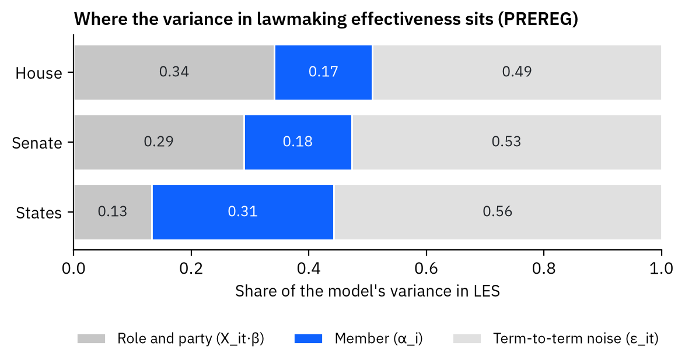
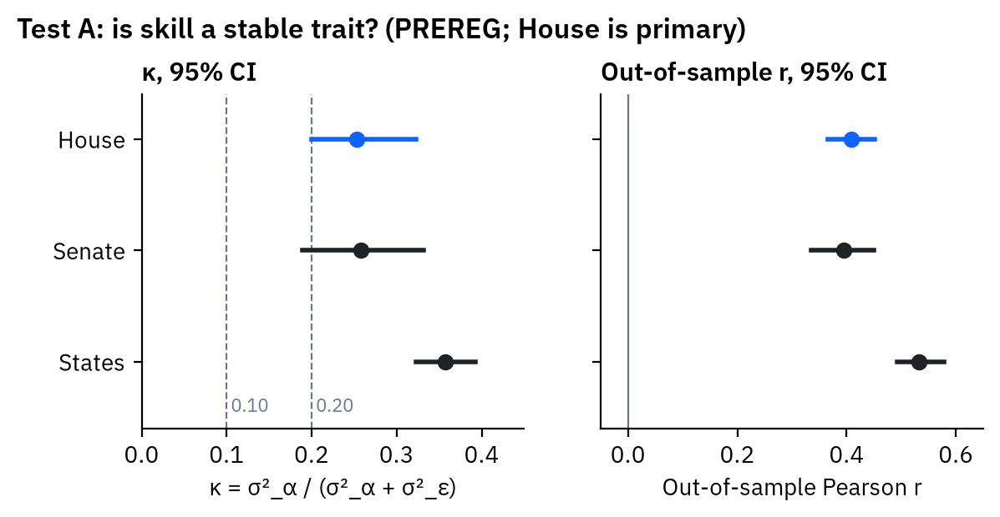
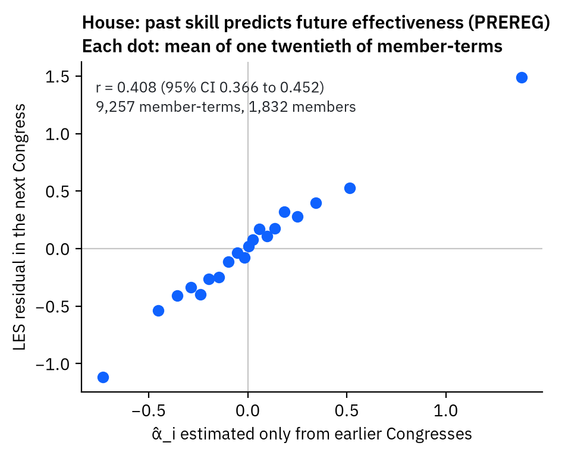
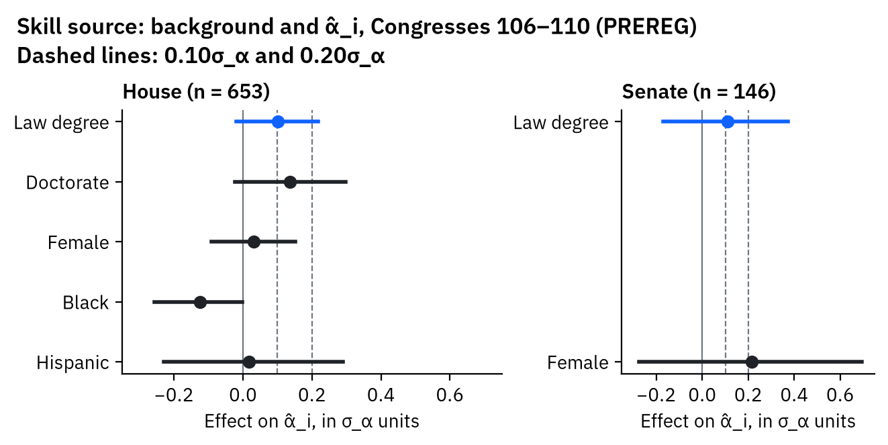
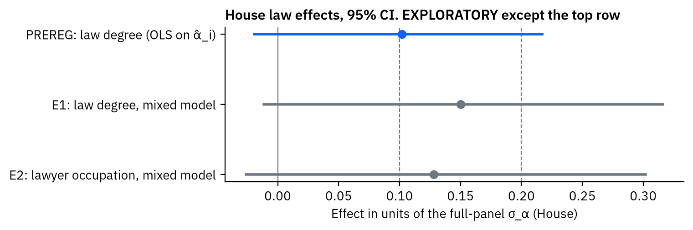

<!-- Every number in this post comes from a var shortcode (written by code/step5_numbers.py from output/)
     or from a table in output/tables/. Thresholds are quoted from PREREG.md. -->

I'm deciding whether to go to law school. My reason for going would be to become someone who makes good policy. That reason depends on three premises:

- **A.** Effective policymakers are a bottleneck for solving world problems.
- **B.** Scientists and economists are not the bottleneck. The answers exist but go unused.
- **C.** Law school is a good way to become an effective policymaker.

Before running any model, I wrote down the tests and the decision rules in a pre-registration ([`PREREG.md`](PREREG.md)). This post reports the parts I could run so far: Test A, and the "skill source" test, which is the first half of C. The results come first, exactly as pre-registered. After that come the places I departed from the plan, then the analyses I added later, which are labeled **exploratory**.

**Short version.** In Congress, some legislators really are more effective than others, year after year. That part of premise A holds up. But members with a law degree are not detectably more effective than members without one. Under my own pre-registered rule, the data gives no recommendation for law school. The analyses I ran after the fact add a caveat. The study can't rule out a modest law-degree effect, so "no evidence" here is not evidence of no effect.

# Data

- **Lawmaking effectiveness.** The Center for Effective Lawmaking's Legislative Effectiveness Scores (LES) measure how far each member's bills get: introduced, acted on in committee, passed by the chamber, and signed into law. They weight bills by significance. I use LES 1.0 for the House and Senate (Congresses –) and the state scores (SLES) for state legislators (–).
- **Background.** Carnes's CLASS data (version 1.9) records each member's education and jobs, but only for Congresses 106–110. It covers  people. I matched  of them to LES by ICPSR number.

# Pre-registered results

## Test A: Is individual skill a distinct trait?

I fit a random-intercept model for each body separately:

LES_it = X_it·β + α_i + ε_it

X_it holds what comes with a member's position: seniority, party, majority status and committee chair. α_i is what stays with the member from term to term. ε_it is what changes from term to term.

The test asks three things:

1. **How large is κ = σ²_α / (σ²_α + σ²_ε)?** This is the share of the variance left after X_it that is stable within a member.
2. **What share of Var(LES_it) does X_it explain?**
3. **Out of sample, does it hold up?** For each Congress t, I estimate α̂_i using only earlier Congresses. Then I check how well α̂_i predicts the member's LES residual at t (Pearson r).

All 95% confidence intervals come from a bootstrap that resamples members.

**Decision rule (from PREREG, House is primary).**

- Supported: κ ≥ 0.20, and the 95% CI of r excludes 0.
- Weak: 0.10 ≤ κ < 0.20, or the CI of r includes 0.
- Not supported: κ < 0.10.

### House (primary)



**Verdict: Claim A is .** κ = , which is at least 0.20, and the CI of r ( to ) excludes 0.

One caveat matters here. The lower end of the κ interval is , just under 0.20. PREREG applies the rule to the point estimate, so the verdict stands. Still, the data can't rule out the "weak" range.

### Senate (secondary)



### State legislatures (secondary)



**What this does and does not show.** All three bodies pass the pre-registered rule. In the House, role and party explain  of the variance in LES, and the member explains . That shows legislators differ in a lasting way. It doesn't show that effective legislators are scarce, or that more of them would solve problems. Premise A needs both, and the scarcity half isn't tested here.

## Skill source: Does a law degree predict skill?

I took α̂_i (each member's estimated skill) from the House and Senate models above, which use every Congress. I then regressed it on background variables for the members in CLASS. Effects are in units of σ_α, the standard deviation of α_i:

- House: σ̂_α = 
- Senate: σ̂_α = 

The 95% CIs come from a bootstrap over members that refits the whole mixed model in every draw.

**Which variable is the law degree?** CLASS has `law_ind`. Carnes's appendix describes "indicators for whether each member held a law degree, MBA, medical degree, master's degree, or PhD". In the data, `law_ind` = 1 for exactly the  rows that record a law school, and for no others. It is not the same as having worked as a lawyer:

-  rows have the degree but no lawyer job.
-  rows have a lawyer job but no degree on record.

The main result uses the degree.

**Counts first.**



Only  of  people hold an economics PhD. PREREG requires at least 30, so **the economics PhD effect is not estimated.**

**Decision rule (from PREREG).**

- Law school favored as a skill source: the effect is at least 0.20σ_α, and the CI lower bound is above 0.
- No evidence: the CI includes 0, or the effect is below 0.10σ_α.
- Anything in between is inconclusive.





**Verdict.**

- House: . The effect is σ_α, with a 95% CI from  to .
- Senate: . The effect is σ_α, with a 95% CI from  to .

**The law-degree effect in three units.** PREREG says "units of σ_α" but not which σ_α (deviation 6 below). So here is the same estimate three ways:

- in LES points;
- in units of the full-panel σ̂_α, which is the PREREG result above;
- in units of σ̂_α from the PREREG model fit only on these CLASS members' terms.

The PREREG threshold is applied in full-panel units. 0.20σ_α is  LES points in the House and  in the Senate. The last three columns are part of exploratory analysis E4 below.



## What the pre-registered rule says

PREREG says the data supports "go to law school" only if all three of these hold:

- κ ≥ 0.20. This is ****.
- The law-degree effect rule is met. This is ****.
- Test C's ratio r ≥ 2. This is still pending.

Because the second condition already fails, ****. Test C can't change that. Under PREREG, the decision now rests on cost, time and reversibility, which this project doesn't measure.

## Test D: What does skill (α_i) contain?

Test D was added to PREREG as Amendment 1, after the Test A and skill-source results were seen and before any Test D data was downloaded. It does not enter the combining rule above. It asks whether α_i, the member effect from Test A, partly reflects things that can be measured in the previous Congress (t−1). Each predictor z is added to the Test A House model one at a time:

LES_it = X_it·β + γ·z_i,t−1/s_z + α_i + ε_it

s_z is the standard deviation of z on that fit's own rows, so γ is in LES points per standard deviation of z. The 99% CI comes from a bootstrap over members ( draws) that refits the model in every draw.

**Rule (from PREREG).** A predictor is supported if its 99% CI excludes 0 and |γ̂| ≥ 0.060 LES points (0.10 × the full-panel σ̂_α of 0.600). Otherwise the result is "no evidence". The share of σ̂²_α explained is descriptive only, with no rule.

**Power, computed before any γ was estimated.** σ̂_γ̂ is a planning figure: the GLS standard error with the Test A variance components held fixed, which uses no LES outcome. (i) is the power for the 99% CI to exclude 0. (ii) is P(supported), the chance that the CI excludes 0 and |γ̂| ≥ 0.060.



One limit follows from this table: **(ii) has a ceiling at the threshold.** If the true γ is exactly 0.060, γ̂ falls below 0.060 about half the time, whatever the sample size. So (ii) at γ = 0.060 can be at most . A true effect right at the threshold is a coin flip under this rule.

**Results.**



- (a), full sample: . γ̂ =  LES points (99% CI  to ), or  × 0.600.
- (b): . γ̂ =  ( to ).
- (c): . γ̂ =  ( to ).
- (d): . γ̂ =  ( to ). (d) is reported alone and is not part of the total share.
- (a), (b) and (c) together explain a share of  of σ̂²_α, on the  member-terms ( members) where all three are available.

**What the CIs show.**

- **(a) and (d): effects as large as the threshold are excluded.** The 99% CI for (a) ( to ) and for (d) ( to ) lies inside ±0.060 LES points. So these are not just "no evidence": an effect of the size the rule calls meaningful is ruled out at this confidence level.
- **(c) is inconclusive.** Its 99% CI includes 0 and reaches , above the threshold.
- **(b) is supported, but it is a sign of skill, not a cause.** (b) is lagged cosponsor standing. Cosponsorship PageRank in t−1 is built from the same kind of bills that LES counts, and members whose bills draw cosponsors tend to have high LES. So (b) partly measures how LES persists from one Congress to the next. It marks skilled members; it does not explain where their skill comes from.
- **Most of α_i is unexplained.** With (a), (b) and (c) together, about  of σ̂²_α remains unexplained.

**Post-result note: planned versus realized precision.** This note was added after the results were seen. It changes no verdict and no rule. The planning figure σ̂_γ̂ held the full-panel variance components fixed (σ̂²_α = , σ̂²_ε = ). The bootstrap standard errors that were realized differ from it:



For (d), the realized standard error () is well below the planned one (). Part of the reason is that the (d) rows have a smaller σ̂²_α (; σ̂²_ε = ). With those components, the GLS figure is . That accounts for about  of the gap, not all of it. For (b), the realized standard error is  times the planned one, so (b) was less precise than planned.

A likely reason for the rest of the gap is that the variance is unequal across members. The GLS figures assume every member has the same σ²_α and σ²_ε, and the bootstrap does not. To check this, the cluster-robust standard error (CR1, clusters = members) was computed on the same fits. This check was also added after the results were seen. Before it was run, the rule was set that it supports the reason for a predictor if the cluster-robust value moves from the model-based GLS value toward the bootstrap value by at least half the gap. For (d), the cluster-robust value is  (model-based , bootstrap ), which closes  of the gap. For (b), it is  (model-based ), which closes . So the check supports unequal variance across members as a reason for both. For (b), the cluster-robust value is still below the bootstrap value, so part of the (b) gap is not explained by this check.

**Other limits.**

- **(b) and (c) cover only t = –.** Bill data comes from govinfo BILLSTATUS, which this project used for Congresses 108–117 (GovTrack blocks automated access). (a) is judged on its full sample; the (a) row for t = – is for comparison only.

**Bugs found and fixed before any γ was estimated.**

- **Parser.** All  BILLSTATUS files were parsed.  of them use older tag names for the bill type and number, and the first parser run skipped them. This was fixed before any predictor was built.  bills list no sponsor in the source.
- **(a) linkage.** (a) was first linked to Voteview by the member's LES-panel ICPSR number in t−1. A party switcher can have a different ICPSR there, so (a) was missing for  member-term (Jefferson Van Drew, t = 118). (a) is now linked by bioguide ID. If a person has two Voteview rows in t−1, the row whose ICPSR is in the LES panel is used, otherwise the row with more votes.
- **(d) linkage.** (d) was linked by CLASS ID = LES-panel ICPSR. CLASS stores some party switchers under only one of their ICPSRs, so  member-terms of  people had no (d), and  people got the wrong first House Congress. (d) is now linked by bioguide ID, and the first House Congress is taken by person. Years in the state legislature changed for  people.

**Implementation choices that PREREG does not specify.**

- Service in t−1 is matched by person (bioguide), because the LES panel gives party switchers a new ICPSR. α_i stays one effect per ICPSR, as in Test A.
- Delegates and resident commissioners are not in the Voteview House roster for every Congress, so their cosponsorships are dropped from the network and their bills from (c).
- For (c), each person has one party per Congress. A cosponsor with no party code in t−1 does not count as cross-party.
- PageRank nodes are the whole House roster of t−1, so members with no edges still get a value. Mass from members with no outgoing edges is spread evenly. Self-edges are dropped.
- (d) is missing, not 0, for a member with no first House Congress in Voteview.
- s_z uses the sample standard deviation and is recomputed in every bootstrap draw.

## Test B: Are expert consensus answers unused?

> **Descriptive only.** The primary set has  policies, fewer than the 20 PREREG needs for a verdict. No confidence interval is reported. The Wilson CI is allowed only for the sensitivity set if it reaches 20 policies, and it has .

**Pool and policies.** The pool is IGM Forum statements with expert consensus (weighted agree of at least 0.80) dated up to the window cutoff. Coder 1 (Claude Code) found  specific US federal policies. Coder 2 coded a random 30 statements for the policy filter, and a random 10 of the 14 policies for adoption. Coder 2 was a separate, fresh Claude Code session, not the person named in the pre-registration (see the deviations list below). Under the counting rule, a policy is in the primary set if coder 1 coded it a policy and coder 2 didn't code it "no". Coder 2 agreed on all . The sensitivity set adds the  statements only coder 2 coded as policies (pool numbers ), giving .

**Do the coders agree?** The samples are very small, so these κ values are imprecise.



The cause-code κ_C is undefined. Both coders gave the same cause, "blocked by interests or veto players", to every one of the  policies they both coded as not adopted. So agreement and chance agreement are both . PREREG reports the cause coding as unreliable when κ_C is below 0.6, and that rule can't be applied to an undefined value. Status: . The coders disagreed on adoption for  of the 10 policies. In both cases one coder said "unclear".

**Coder 1's and coder 2's adoption codes, side by side** (the 10 policies both coded):



**Share adopted (π).** Primary set ( policies;  change-type, which leaves out the two policies that favor keeping things as they are: LNG exports and BLS funding):



Under the main rule,  of  policies were adopted at some point in the window (π = ). Among change-type policies, π is . Counting "unclear" as not adopted (S1) lowers π to . In the sensitivity set, adopted any time, all policies: . Coder 1 gave "blocked by interests or veto players" as the cause for all  primary-set policies it coded as not adopted. With so few policies, these numbers describe this pool; they don't test whether consensus answers go unused.

## Lockdown data: Do law-trained leaders lock down sooner?

> **.** The replication below misses the pre-set tolerance on one term, so the law-trained result is reported next to the gap and should be read with it.

Wehner and Hallerberg (*Journal of Politics*) study how fast  countries ordered a nationwide stay-at-home measure during the COVID pandemic. Their replication files have a daily country panel ( rows,  columns) and a leaders file ( rows) that records each leader's degree subject. PREREG asks for two things: first replicate their Table A5, column (1), then add a law-trained leader indicator.

**Model.** This is the specification in their Stata file, fit in Python (statsmodels PHReg). It is a Cox model of the days until the first stay-at-home order, with the time-varying COVID-death indicator and their regime, leader, health-minister, economic, political, religion and region controls. Ties use the Breslow method (Stata's default), with model-based standard errors, no strata and no clustering. The sample has  country-days,  countries and  stay-at-home orders. No covariate is missing in the risk set, so  records are dropped.

The five religion dummies sum to one in every country, so together they duplicate the baseline hazard, and Stata drops one of them automatically. I drop the last one listed (Buddhist). Dropping a different one (Christian) gives the same log likelihood and the same non-religion hazard ratios (match: ).

**Replication check.** The tolerance was set before the fit: each HR within  and each CI end within .



The scientist-leader term matches. The doctor-health-minister term doesn't: the HR is  off and the upper CI end is  off. So the replication **** the check. I didn't change the model to close the gap. Fitting it again with a much tighter convergence tolerance gives the same log likelihood and hazard ratios to 6 decimal places (same: ), so the gap isn't a convergence problem. The cause is unknown, and the paper's sample counts weren't checked against this one.

**Law-trained leader.** The indicator is the leaders file's `law` ("Leader degree subject - Law"), joined by country code. The leader and health-minister names agree in both files. It is added to column (1), with nothing else changed.



The hazard ratio is  (95% CI  to ). The interval is wide and includes 1. PREREG sets no threshold here, so this is an estimate, not a test.  law-trained leader is also coded as a scientist.  leaders in the leaders file have no `law` code, and none of them are in the -country sample.

# Deviations from the pre-registration

Each item is listed in full in [`ANALYSIS_LOG.md`](ANALYSIS_LOG.md).

1. **A discarded first run.** My first run of Test A added a chamber term to the state model and fit three extra models. None of these are in PREREG. I discarded that run before reporting anything; the files are in `archive/discarded_run1/`. Every result above uses the PREREG model exactly.
2. **Control variables.** PREREG says "background variables" but doesn't list them. I chose doctorate, female, Black and Hispanic.
3. **A rule I added after seeing the counts.** A background variable enters a model only if at least 10 members hold it. I set this after seeing the counts but before seeing any coefficients. It drops doctorate, Black and Hispanic from the Senate model.
4. **Sample.** The law-degree test can use only Congresses 106–110, because that is all CLASS covers.
5. **What counts as the degree.** `law_ind` counts any law degree, not only the JD. CLASS's doctorate flag also counts Ed.D. and Ed.S. degrees.
6. **Which σ_α.** PREREG says effects are "in units of σ_α" but doesn't say which σ_α. I added this after seeing the results. Every law effect is now reported in LES points, in units of the full-panel σ̂_α ( in the House) and in units of the sample's own σ̂_α. The PREREG threshold, and the power at it, use the full-panel σ̂_α.
7. **Not yet run.** Test C (which degree leads to policy roles?) isn't done.
8. **Linking people, not ID numbers.** The LES panel and CLASS use ICPSR numbers, and a party switcher can have two. The skill-source test above matched them by ICPSR, so three CLASS members were dropped and a few entered twice. The result above is unchanged as the pre-registered one. A re-run that links by person (bioguide ID) gives a House law-degree effect of σ_α (95% CI  to ): . The Senate gives σ_α ( to ): . Leaving out the one member whose CLASS records disagree on the law degree (Ralph Hall) gives σ_α in the House: . Test A run with one ID per person ( House members have more than one ICPSR, covering  member-terms) gives a House κ of  (95% CI  to ) and r = : . Exploratory analyses E1, E2 and E4 below now link by person.
9. **Lockdown replication.** The Table A5 replication misses the pre-set tolerance on the doctor-health-minister term. Under a fallback rule set after the first fit missed the tolerance, but before the final refit and before any law-trained model was fit, the law-trained leader estimate is still reported, labeled "", next to the gap. One religion dummy is dropped for collinearity, as Stata does.
10. **Test B coders and late rules.** The pre-registration named a person as coder 2. Coder 2 was instead a fresh Claude Code session, run in a separate folder, so both coders are Claude models. This wasn't logged until after coder 2 had coded. Two rules were added after both coders had coded but before either set of adoption codes was opened: how disagreements and "unclear" codes count (S1–S3), and the split into change-type and preserve-type policies.

# Exploratory analyses

> **Everything in this section is EXPLORATORY.** None of it was in PREREG.md. I added these analyses after seeing the results above. They can't change any verdict above, and they deserve less weight.

**E1 and E2: Law background inside the mixed model.** Regressing α̂_i on background understates effects, because α̂_i is shrunk toward zero, more so for members with few terms. So I put the law variable inside the model instead:

LES_it = X_it·β + γ·LAW_i + α_i + ε_it

The sample is the  matched CLASS members, with all their terms:

- House:  members,  member-terms.
- Senate:  members,  member-terms.

Each effect is shown in LES points, in units of the full-panel σ̂_α ( in the House,  in the Senate), and in units of σ̂_α from the pre-registered model on this sample ( and ). The full-panel units are the ones the PREREG threshold uses. Here they divide by a fixed full-panel σ̂_α, so their CIs ignore uncertainty in that σ̂_α. I ran the law degree, then lawyer occupation (CLASS job codes 1–4).



What the House results show:

- **Law degree:**  LES points, or  full-panel σ_α (95% CI  to ). This is larger than the pre-registered , but the CI still includes 0.
- **Lawyer occupation:** much the same:  full-panel σ_α ( to ).
- **Degree and occupation can't be separated.** I also fit a model with both. In the House,  members have both,  have only the degree and  have only the occupation. With so few members who have one but not the other, the data can't say which of the two matters, so I don't report the two terms as separate findings.

**E4: Could this study have detected a law effect?** I measured precision with the bootstrap standard error (the standard deviation of the bootstrap draws). The smallest effect detectable with 80% power (two-sided, α = 0.05) is  times that standard error. Power is computed at the PREREG threshold, 0.20 × the full-panel σ̂_α.

- **Pre-registered estimate (House):**
  - Bootstrap standard error: σ_α.
  - Smallest detectable effect: σ_α.
  - Power at the threshold: .
  - But that estimate is attenuated by the shrinkage in α̂_i, so a true 0.20σ_α effect would show up smaller than 0.20 on this scale.
- **Mixed-model estimate (E1, House):**
  - Bootstrap standard error: σ_α.
  - Smallest detectable effect: σ_α.
  - Power at the threshold: .
- **Senate:** power at the threshold is lower still:  for the pre-registered estimate and  for E1.

**In plain terms:** in the House, the less-biased mixed model has less than 80% power to detect a law-degree effect of the size PREREG called meaningful. The Senate has much less. "No evidence" here does not mean "no effect".

**E3: Does skew drive Test A?** LES is right-skewed, so a few outlier members could inflate σ²_α. I refit the House model with LES replaced by its rank within each Congress, mapped to a normal scale (an inverse-normal rank transform).



κ rises and r barely moves, so Test A is not an artifact of a few extreme scores.

**E5: How rare are economics PhDs?**  of  CLASS members hold one, or  (Wilson 95% CI  to ). Restricting to the  matched members gives  ( to ). Even the upper bounds fall far short of the 30 holders needed for a test. Congress, at least, contains almost no economists to compare against lawyers.

# Limits, in plain language

- **Selection.** People who go to law school differ from people who don't, before they ever enroll. So do people who win elections. These are comparisons among people who already made it into Congress. They say nothing about what law school would do for me.
- **α_i is not personal skill alone.** It includes everything that stays with a member across terms: staff, donor and party networks, a safe seat, the district's interests, and the reputation that draws co-sponsors. "Skill" here means "whatever makes this member's bills advance, beyond their role and party."
- **LES measures how far bills advance, not whether they are good policy.** An effective legislator by this measure can pass bad laws.
- **Legislators are one kind of policymaker.** Agency staff, judges, executives and advisers aren't in these data. That's a large gap for premise C, since many lawyers who shape policy never run for office.
- **Coverage.** Education data covers only Congresses 106–110. I have no degree data for state legislators.
- **Missing data.**  House rows (delegates without an ICPSR number) are dropped.
- **Scale.** LES is scaled within each chamber and state, so the size of α_i can't be compared across bodies, only κ and r.

# Reproducing this post

All code is in `code/`, and every result is in `output/`. Exploratory results are in `output/exploratory/`. Every number in this post is filled in from `_variables.yml` or from `output/tables/`, which `code/step5_numbers.py` generates from `output/`. None is typed by hand. Data sources and hashes are listed in [`DATA_SOURCES.md`](DATA_SOURCES.md).
